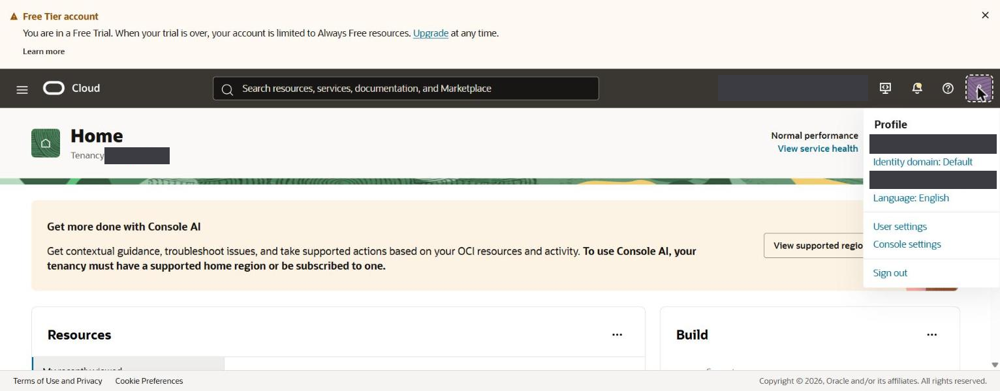
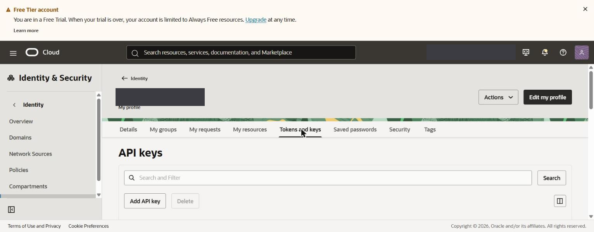
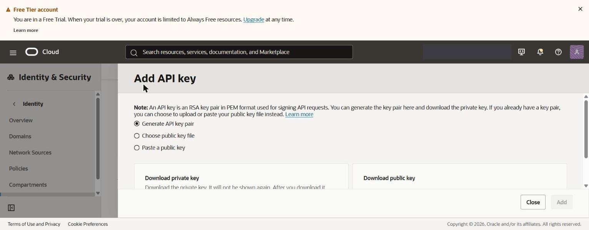
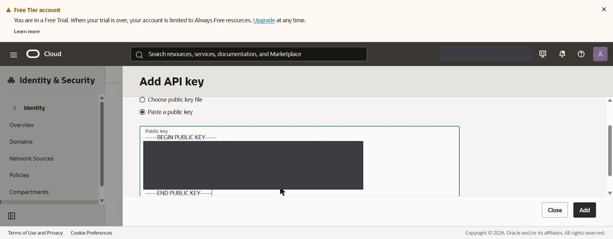
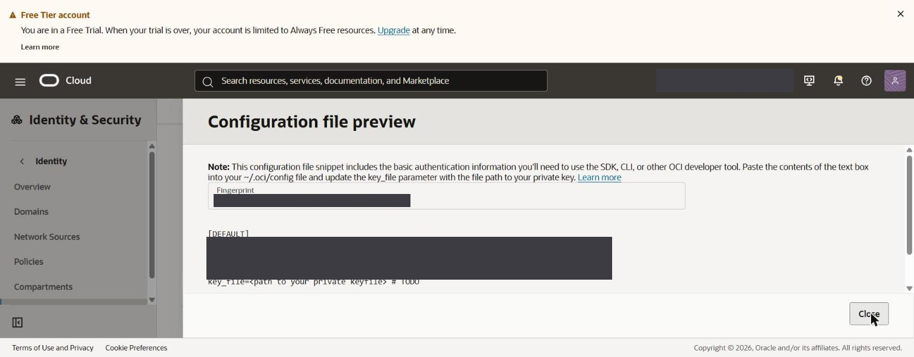

# oci-out-of-host-capacity-fix — Oracle Cloud Free Tier ARM instance auto-creator

Get an Oracle Cloud **Always Free** server — a free ARM VPS (Ampere A1, up to 4 OCPU / 24 GB RAM, or AMD E2.1.Micro)
when the console only says **"Out of host capacity"**. The launcher retries for you, every minute,
until Oracle has room — on **Windows, Linux or macOS** — and pops up a message when it succeeds.

> Fork of [mohankumarpaluru/oracle-freetier-instance-creation](https://github.com/mohankumarpaluru/oracle-freetier-instance-creation)
> (MIT, © 2023 Mohan Kumar Paluru). Thank you for the original work!

**[Website](https://northbit-labs.github.io/oci-out-of-host-capacity-fix/)** · **[Español más abajo](#español)**

## What's new compared to the original

| | Original | oci-out-of-host-capacity-fix |
|---|---|---|
| Platforms | Ubuntu + bash scripts | Windows native (no WSL), Linux, macOS |
| Setup | edit `oci.env` by hand, create keys yourself | `setup_wizard.py` creates the API key, SSH key, `oci_config` and `oci.env` |
| Size | fixed 2 OCPU / 12 GB | `OCPUS` / `MEMORY_GB`, validated against Always Free |
| Grow later | — | `python main.py resize` (e.g. 2/12 → 4/24), retrying on capacity too |
| Network | needs an existing subnet (takes the first one) | uses a public subnet, or creates VCN + internet gateway + route + subnet |
| Paths with spaces | rejected | fine (`C:/Users/Jane Doe/...`) |
| Safety | — | refuses anything that would leave Always Free (OCPU, RAM, 2 micros, 200 GB storage) |
| Dry run | — | `python main.py check` (read-only) |
| Notifications | Gmail, Discord (Telegram only in the bash wrapper) | + desktop pop-up (Windows always-on-top, Linux `notify-send`, macOS), Telegram in Python; says how long it took and how many attempts |
| Tests | — | offline unit tests with mocks |

## Requirements

- An Oracle Cloud account (Free Tier or Pay As You Go) — [sign up](https://signup.cloud.oracle.com).
- **Python 3.12** (3.11 and 3.13 also work). Newer versions such as 3.14+ may fail to install the
  `oci` package because some of its dependencies (`crc32c`, `python-pkcs11`) have no prebuilt wheels yet.
- A computer that stays on while it tries (it can take hours or days in busy regions).

## Quick start — Windows

1. Install Python 3.12 from [python.org](https://www.python.org/downloads/) (keep "py launcher" ticked).
2. Download this repo (green **Code** button → Download ZIP) and unzip it, e.g. to `Documents\oci-out-of-host-capacity-fix`.
3. Open PowerShell in that folder and run:
   ```powershell
   powershell -ExecutionPolicy Bypass -File setup_windows.ps1
   ```
   This creates `.venv`, installs the requirements and starts the wizard (see [the wizard](#the-wizard)).
4. Start it in the background:
   ```powershell
   powershell -ExecutionPolicy Bypass -File start_windows.ps1
   ```
   It first runs `main.py check`, then keeps trying without a console window. You can close PowerShell.
   Follow it with `Get-Content launch_instance.log -Wait -Tail 5`; stop it with `Stop-Process -Id <PID>`.

## Quick start — Linux / macOS

```bash
git clone https://github.com/northbit-labs/oci-out-of-host-capacity-fix && cd oci-out-of-host-capacity-fix
python3.12 -m venv .venv && . .venv/bin/activate
pip install -r requirements.txt
python setup_wizard.py
python main.py check
nohup python main.py > python_error.log 2>&1 &
```

The original bash scripts (`setup_env.sh`, `setup_init.sh`) are still included and work as before.

## The wizard

`python setup_wizard.py` asks a few questions and writes everything. Nothing is sent anywhere.

1. It creates an **API key** (`oci_api_key.pem` + `oci_api_key_public.pem`) and prints the public part.
2. In the [OCI console](https://cloud.oracle.com): **profile icon (top right) → User settings → Tokens and keys →
   Add API key → Paste a public key**, paste it, click **Add**.
3. Oracle shows a **Configuration file preview**. Copy it and paste it into the wizard
   (it reads `user`, `tenancy`, `region` and checks the `fingerprint` matches the key it created).

<details>
<summary><b>Screenshots of steps 2 and 3</b> (personal data blacked out)</summary>

1. Profile icon → **User settings**
   
2. **Tokens and keys** tab → **Add API key**
   
3. Choose **Paste a public key**
   
4. Paste the public key the wizard printed and click **Add**
   
5. Copy the **Configuration file preview** into the wizard
   

</details>
4. Choose the shape, OCPUs/RAM (checked against Always Free), disk, Ubuntu version and optional notifications.
5. It creates an **SSH key** (`ssh_key` / `ssh_key.pub`) to log in to the server later:
   `ssh -i ssh_key ubuntu@<public IP>`.

Existing keys are reused, and existing `oci_config` / `oci.env` are backed up as `.bak`.
These files are in `.gitignore`: never commit or share them.

## Commands

| Command | What it does |
|---|---|
| `python main.py` | Launch: retry until the instance exists, then notify and exit. |
| `python main.py check` | Read-only: shows AD, size, storage in use, subnet, image and the Always Free check. |
| `python main.py resize` | Grow the A1 named `DISPLAY_NAME` to `RESIZE_OCPUS`/`RESIZE_MEMORY_GB`. **The instance reboots.** |
| `--env other.env` | Use another settings file. |

Tip: a 2 OCPU / 12 GB instance is usually found sooner than 4/24. Get that first, then run `resize`.

## Settings (`oci.env`)

See [`oci.env.example`](oci.env.example) for all of them. The important ones:

| Variable | Default | Meaning |
|---|---|---|
| `OCI_CONFIG` | `~/.oci/config` | Path to `oci_config` (spaces OK). |
| `OCT_FREE_AD` | `AD-1` | AD suffix(es), comma separated. The launcher rotates through them. |
| `OCI_COMPUTE_SHAPE` | `VM.Standard.A1.Flex` | Or `VM.Standard.E2.1.Micro`. |
| `OCPUS` / `MEMORY_GB` | `2` / `12` | Size of the A1 instance (max 4 / 24 in total). |
| `RESIZE_OCPUS` / `RESIZE_MEMORY_GB` | `4` / `24` | Target for `resize`. |
| `BOOT_VOLUME_SIZE` | `50` | GB, minimum 50. All volumes together must fit in 200 GB. |
| `OCI_SUBNET_ID` | empty | Empty = first public subnet, or create one if `CREATE_NETWORK=True`. |
| `ASSIGN_PUBLIC_IP` | `True` | Needed to SSH from home. |
| `OS_VERSION` | `22.04` | Ubuntu version (`images_list.json` lists what is available). |
| `REQUEST_WAIT_TIME_SECS` | `60` | Pause between attempts. Below 30 s you will get `TooManyRequests`. |
| `DESKTOP_NOTIFY` | `True` | Pop-up / desktop notification on success or error. |
| `DISCORD_WEBHOOK`, `TELEGRAM_TOKEN` + `TELEGRAM_USER_ID`, `NOTIFY_EMAIL` + `EMAIL` + `EMAIL_PASSWORD` | empty | Optional extra notifications (Gmail needs an [app password](https://myaccount.google.com/apppasswords)). |

## Costs: why the estimator says ~8 €/month but you pay 0

- Oracle's **cost estimator** prices the A1 shape at list price and **does not subtract the Always Free
  allowance**, so 4 OCPU / 24 GB shows a monthly figure. The Always Free allowance is 3,000 OCPU-hours and
  18,000 GB-hours of A1 per month — exactly 4 OCPU / 24 GB running 24/7 — plus 200 GB of block storage.
- In the console, Always Free shapes and resources are labelled **"Always Free-eligible"**.
- A **Free Tier** account cannot be charged at all unless you upgrade it. A **Pay As You Go** account is
  only charged for what goes **beyond** the allowance — which is why this launcher refuses any request that
  would go beyond it (`python main.py check` shows the numbers).
- Things that do cost money on Pay As You Go: other shapes, more than 200 GB of volumes, extra backups beyond
  the free 5, outbound traffic beyond 10 TB/month.
- On Free Tier accounts Oracle may **reclaim idle** Always Free instances (very low CPU, network and memory
  use for 7 days). Upgrading to Pay As You Go removes that rule; set a budget alert if you do.

Always check Oracle's current [Always Free resources](https://docs.oracle.com/iaas/Content/FreeTier/freetier_topic-Always_Free_Resources.htm) page.

## FAQ

### How do I fix "Out of host capacity" on Oracle Cloud Free Tier?

You can't fix it on Oracle's side: it means the region has no free A1 capacity right now. The workaround is to keep
retrying until a slot opens, which is what this launcher does (`python main.py`). Asking for 2 OCPU / 12 GB first and
using `resize` later usually gets you a server sooner.

### The log is full of "Out of host capacity". Is it broken?

No, that is the normal answer while Oracle has
no room. The launcher keeps going. Busy regions can take days.

### How long did it take for others?

When it succeeds, the notification says how long it took and how many attempts it needed, in the form
`Got it after <hours>h <minutes>m and <N> attempts.` (counted since the launcher started). If you get one, a screenshot of it
with your region in an [issue](https://github.com/northbit-labs/oci-out-of-host-capacity-fix/issues) helps others
know what to expect.

### `LimitExceeded`?

Before launching, the launcher already checks that your request fits in Always Free, so a
`LimitExceeded` during the retries is usually a false alarm from Oracle: it checks whether your instance
was created and, if not, keeps retrying. If it never stops, look in the console (stopped instances still count).

### Does `resize` lose data?

No, but the instance reboots. If there is no capacity it keeps retrying.

**More errors:** see [TROUBLESHOOTING.md](TROUBLESHOOTING.md).

## Development

```bash
python -m unittest discover tests
```

All OCI calls are mocked; the tests never touch a real account.

## Credits

- [mohankumarpaluru/oracle-freetier-instance-creation](https://github.com/mohankumarpaluru/oracle-freetier-instance-creation) — the original project this is based on.
- [hitrov/oci-arm-host-capacity](https://github.com/hitrov/oci-arm-host-capacity) — the idea that started it all.
- Oracle docs: [LaunchInstance](https://docs.oracle.com/en-us/iaas/api/#/en/iaas/20160918/Instance/LaunchInstance), [UpdateInstance](https://docs.oracle.com/en-us/iaas/api/#/en/iaas/20160918/Instance/UpdateInstance).

Not affiliated with Oracle. Use at your own risk; you are responsible for your account and its costs.

---

## Español

Consigue un servidor **Always Free** de Oracle Cloud — un VPS ARM gratis (Ampere A1, hasta 4 OCPU / 24 GB de RAM, o AMD
E2.1.Micro) cuando la consola solo responde **"Out of host capacity"**. El programa reintenta por ti cada
minuto hasta que Oracle tenga hueco — en **Windows, Linux o macOS** — y te avisa con una ventana cuando lo consigue, indicando cuánto tardó y cuántos intentos hizo.

Basado en [mohankumarpaluru/oracle-freetier-instance-creation](https://github.com/mohankumarpaluru/oracle-freetier-instance-creation) (MIT).

### Novedades respecto al original

- **Windows nativo**, sin WSL: `setup_windows.ps1` y `start_windows.ps1`.
- **Asistente** (`setup_wizard.py`) que crea la llave de API, la llave SSH, `oci_config` y `oci.env`.
- **OCPU y memoria configurables** (`OCPUS`, `MEMORY_GB`), comprobadas contra los límites gratuitos.
- **Ampliación posterior**: `python main.py resize` (p. ej. de 2/12 a 4/24), también reintentando por capacidad.
- **Red automática**: si no tienes subred pública crea VCN + puerta a internet + ruta + subred (gratis).
- **Rutas con espacios** permitidas.
- **Comprobación de seguridad**: se niega a crear nada que salga de Always Free. `python main.py check` lo muestra sin cambiar nada.
- **Avisos**: ventana siempre encima en Windows, notificación en Linux/macOS, además de Telegram, Discord y Gmail.
- **Pruebas automáticas** sin conexión.

### Requisitos

- Cuenta de Oracle Cloud (Free Tier o Pay As You Go).
- **Python 3.12** (también 3.11 o 3.13). Con 3.14 o más nuevos puede fallar la instalación de `oci`
  porque algunas dependencias (`crc32c`, `python-pkcs11`) aún no tienen ruedas precompiladas.
- Un ordenador encendido mientras lo intenta (en regiones con mucha demanda pueden ser días).

### Paso a paso en Windows

1. Instala Python 3.12 desde [python.org](https://www.python.org/downloads/) (deja marcado "py launcher").
2. Descarga este repositorio (botón verde **Code** → Download ZIP) y descomprímelo, p. ej. en `Documentos\oci-out-of-host-capacity-fix`.
3. Abre PowerShell en esa carpeta y ejecuta:
   ```powershell
   powershell -ExecutionPolicy Bypass -File setup_windows.ps1
   ```
4. El asistente te muestra una llave pública. En la [consola de OCI](https://cloud.oracle.com):
   **icono de perfil (arriba a la derecha) → User settings → Tokens and keys → Add API key → Paste a public key**,
   pégala y pulsa **Add**. Oracle muestra una **vista previa del archivo de configuración**: cópiala y pégala en el asistente.
5. Elige forma, OCPU/RAM, disco, versión de Ubuntu y avisos opcionales.
6. Arráncalo en segundo plano:
   ```powershell
   powershell -ExecutionPolicy Bypass -File start_windows.ps1
   ```
   Puedes cerrar PowerShell. Para ver cómo va: `Get-Content launch_instance.log -Wait -Tail 5`.
   Para pararlo: `Stop-Process -Id <PID>` (el PID se muestra al arrancar).
7. Cuando salga la ventana de aviso, busca la IP pública en la consola (Compute → Instancias) y entra con
   `ssh -i ssh_key ubuntu@<IP>`.

Consejo: una instancia de 2 OCPU / 12 GB suele salir antes que una de 4/24. Consigue esa y luego ejecuta
`start_windows.ps1 resize` (la instancia se reinicia).

### Costes: por qué el estimador dice ~8 €/mes y no se cobra

- El **estimador de costes** de Oracle calcula la forma A1 a precio de lista y **no descuenta lo gratuito**.
  Lo gratuito son 3.000 horas de OCPU y 18.000 GB-hora de A1 al mes (justo 4 OCPU / 24 GB encendidos todo
  el mes) y 200 GB de almacenamiento.
- En la consola aparecen marcados como **"Always Free-eligible"**.
- Una cuenta **Free Tier** no puede generar cargos si no la actualizas. En **Pay As You Go** solo se cobra
  lo que pase del límite gratuito; por eso este programa se niega a pedir más (`python main.py check` muestra las cuentas).
- Sí cuestan en Pay As You Go: otras formas, más de 200 GB de volúmenes, más de 5 copias de seguridad,
  más de 10 TB/mes de tráfico de salida.
- En cuentas Free Tier, Oracle puede **recuperar instancias inactivas** (uso muy bajo durante 7 días).

Consulta siempre la página oficial de [recursos Always Free](https://docs.oracle.com/iaas/Content/FreeTier/freetier_topic-Always_Free_Resources.htm).

No está afiliado a Oracle. Úsalo bajo tu responsabilidad.
